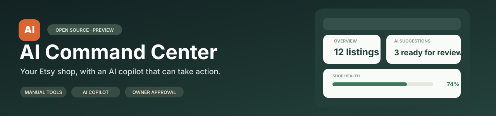
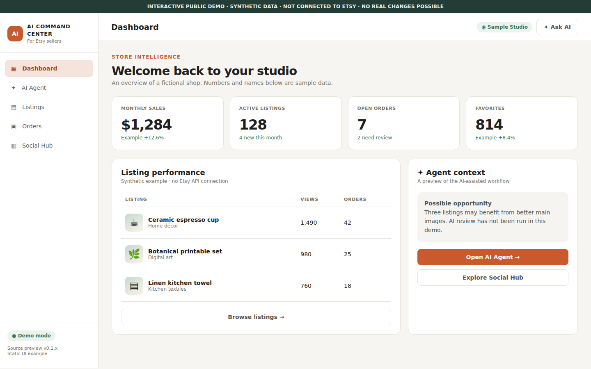
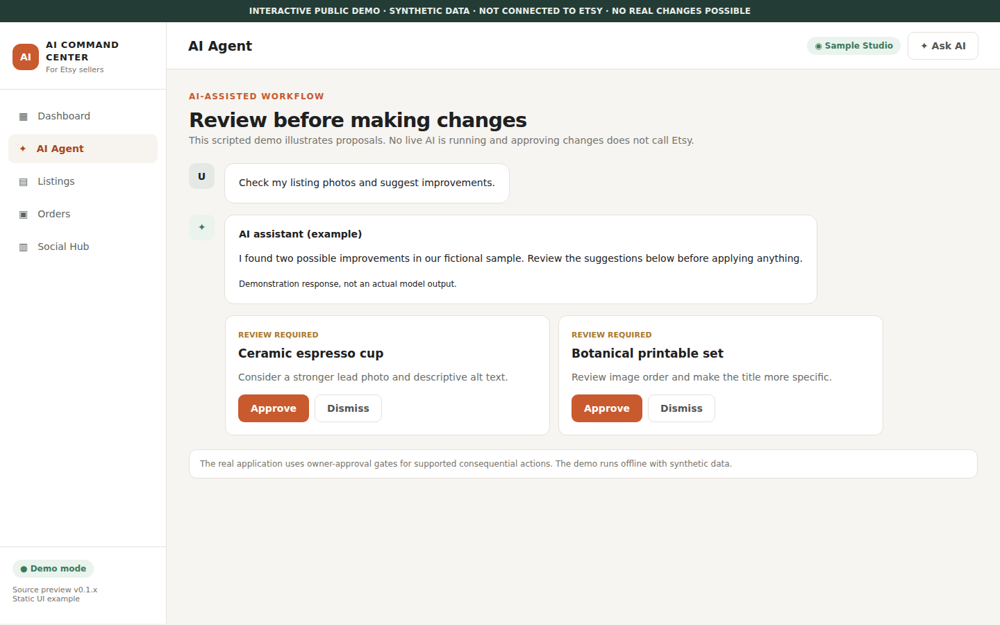

<p align="center">
  
</p>

<p align="center">
  <a href="https://github.com/Bl0ck154/etsy-ai-command-center/actions/workflows/ci.yml"></a>
  <a href="https://github.com/Bl0ck154/etsy-ai-command-center/releases"></a>
  <a href="https://github.com/Bl0ck154/etsy-ai-command-center/actions/workflows/compatibility.yml"></a>
  <a href="LICENSE"></a>
  <a href="https://github.com/Bl0ck154/etsy-ai-command-center/stargazers"></a>
  
</p>

<p align="center">
  <b>Manual Etsy shop management + an AI copilot that can prepare real work.</b><br>
  Listings, orders, inventory, media, shop insights and approval-based AI workflows in one self-hosted dashboard.
</p>

<p align="center">
  <a href="#preview">Preview</a> ·
  <a href="#features">Features</a> ·
  <a href="#getting-started">Quick start</a> ·
  <a href="#project-status">Project status</a> ·
  <a href="docs/RELEASE-READINESS.md">Readiness report</a> ·
  <a href="CONTRIBUTING.md">Contribute</a>
</p>

> [!IMPORTANT]
> **Public preview (v0.1.x), not production-certified.** This is source from a self-hosted project adapted for public release. Clean installs, integrations and the full test suite are still being verified. **Review the [release-readiness report](docs/RELEASE-READINESS.md) and [limitations](docs/LIMITATIONS.md) before connecting a real shop.**

## Preview

[**▶ Open the interactive demo**](https://bl0ck154.github.io/etsy-ai-command-center/demo/) — synthetic shop, no account, no keys, and no Etsy actions.
[View the demo source](docs/demo/index.html).

<p align="center"></p>
<p align="center"><sub>Real screenshot of the <a href="https://bl0ck154.github.io/etsy-ai-command-center/demo/">interactive static demo</a> using synthetic data. It is <strong>not</strong> a screenshot of the connected production application.</sub></p>

<details>
<summary><b>See the AI approval workflow concept</b></summary>



<sub>Screenshot of scripted demonstration UI. No live model is running; approvals modify only the demonstration state.</sub>

</details>

## Why this exists

Sellers need conventional controls for everyday shop management and an AI assistant for tasks that benefit from analysis. Both belong in the same workspace.

**AI Command Center** combines a manual Etsy shop dashboard with a tool-using assistant. The agent can inspect available shop context and listing images, then **prepare changes for owner approval**.

A typical workflow:
1. Check listings, orders or performance in the dashboard.
2. Ask: *“Find listings with weak main images and suggest improvements.”*
3. The AI retrieves relevant shop data and prepares proposed actions where supported.
4. Review each change before using an available confirmation workflow.

The workflow is an illustration, not a claim that all models or new installations can complete every step unattended.

## Features

| Area | Included source | Requirements |
| --- | --- | --- |
| 📊 **Shop dashboard** | Listings, orders, inventory, reviews, sales, analytics and settings | Authorized Etsy API access |
| 🛠️ **Manual management** | Create/edit drafts, media, bulk operations, inventory tools | Verify each write path before live use |
| ✦ **Actionable AI copilot** | Tool calling, shop context, image analysis, proposed changes | Compatible AI model and credentials |
| 🖼️ **Image intelligence** | Listing vision, image planning and media generation | Vision/image API provider |
| 💬 **Messages** | Context-based drafts, owner approval, optional learning | Separate Etsy Messages Bridge, not bundled |
| 📣 **Social campaigns** | AI campaign planning, media QA, approval and scheduling modules | Partial; autonomous producer not included |
| 🔌 **GPT Actions** | Scoped OAuth, OpenAPI contracts and controlled Etsy operations | Optional advanced setup |

See [features](docs/FEATURES.md) and [integration requirements](docs/INTEGRATIONS.md).

## Getting started

Requires **Node.js 22+** and npm. Live shop features also need credentials from your approved Etsy Open API v3 application. AI features need a compatible provider.

```bash
git clone https://github.com/Bl0ck154/etsy-ai-command-center.git
cd etsy-ai-command-center
npm ci
cp .env.example .env
# Edit .env with your own credentials and unique session secret.
npm run doctor
npm start
```

The example sets `PORT=3010`. Open **http://localhost:3010** after the server starts.

> [!NOTE]
> This is a source installation, not a hosted Etsy app or ready-made OAuth integration. Messages Bridge, social providers and shared storage must be set up separately when needed. An accessible UI does not imply every integration is configured.

[Detailed quick start](docs/QUICKSTART.md) · [Etsy OAuth](docs/ETSY-OAUTH.md) · [Configuration](docs/CONFIGURATION.md) · [External integrations](docs/INTEGRATIONS.md)

## AI that keeps the seller in control

- **Analyze:** access relevant shop records, listing information, sales and images using the agent's declared tools.
- **Prepare:** create proposals for listing updates, media changes, variations and other supported actions.
- **Approve:** consequential workflows require an explicit confirmation gate.
- **Control:** automatic publishing and message triggers are disabled by default in the sample configuration.

The source defines **47 tool-runtime contracts** across reading data, proposed changes, navigation and helper operations. This is an interface count, not 47 independently verified production features.

## Project status

| Verification | Status |
| --- | --- |
| Public-source privacy cleanup | Performed for initial snapshot |
| Syntax checks | Automated |
| Node 22 clean install + localhost health | **Passed on GitHub Actions**; other environments untested |
| Hosted offline smoke | **68 selected tests passed** on Node 22 |
| Full unit and browser test suite | **Not yet certified green** |
| Other sellers' Etsy OAuth and live write workflows | **Not independently validated** |
| Messages Bridge | Optional external service |
| Autonomous Social producer | Not bundled |
| Production readiness | **Not declared** |

[Release-readiness audit](docs/RELEASE-READINESS.md) · [Testing](docs/TESTING.md) · [Maintainer sync](docs/MAINTAINER-SYNC.md) · [Deployment](docs/DEPLOYMENT.md) · [AI providers](docs/AI-PROVIDERS.md) · [Known limitations](docs/LIMITATIONS.md) · [FAQ](docs/FAQ.md) · [Roadmap](docs/ROADMAP.md)

## Development

```bash
npm run doctor           # redacted configuration preflight
npm run check            # quick syntax checks
npm run verify:source    # full source syntax and public-snapshot safety checks
npm run test:unit        # offline unit tests (requires installed dependencies)
```

Code is split across `api/` (backend and orchestration), `public/` (web UI), `workers/` (optional processes), `tests/` and `docs/`.

## Contribute and support

Bug reports and focused pull requests are welcome. Please use **synthetic listings, redacted screenshots and no customer data** in issues. Read [CONTRIBUTING.md](CONTRIBUTING.md) and [SECURITY.md](SECURITY.md). [Sharing kit](docs/SHARING.md) includes a concise project description and relevant hashtags.

If you find the project useful, a GitHub star helps other Etsy sellers discover it. ⭐

## License and attribution

[MIT License](LICENSE).

**The term 'Etsy' is a trademark of Etsy, Inc. This Application uses Etsy's API, but is not endorsed or certified by Etsy.**

Etsy API access, browser automation, use of Etsy data with AI and apps used by multiple sellers are subject to Etsy's current requirements and permissions. This project provides no credentials or authorization to bypass those rules.
